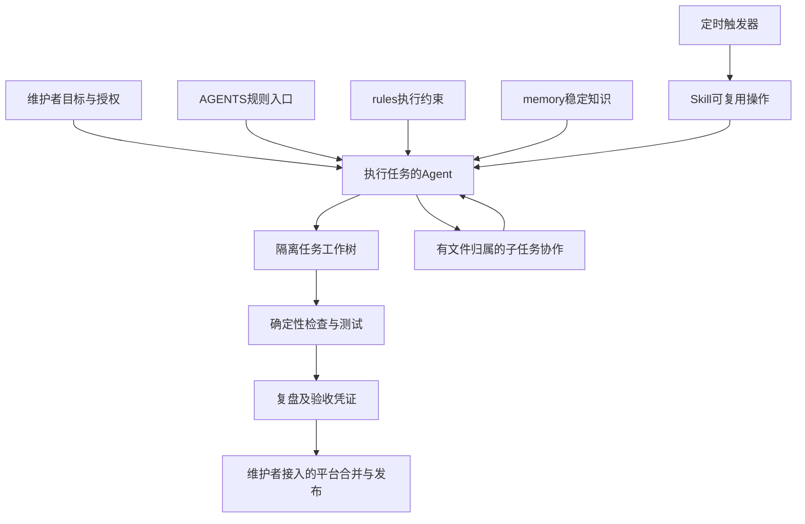

# 模板抽取记录与长期演进

本文记录通用Agent项目模板的形成过程、实际交付内容、验证证据和后续维护方式。规则正文继续维护在rules，操作流程维护在Skill，本文提供设计背景和检索入口，不建立另一份执行规范。

## 目标与交付位置

2026-10-07，从一个已有业务项目的Agent工程机制中抽取可复用模板。目标是让其他新项目或已有项目复用规则入口、文件记忆、Skill、定时触发、协作开发和交付检查，同时不继承原业务、私有资料或管理员授权。

公开仓库：[agent-project-template](https://gitee.com/bwg/agent-project-template)，默认分支main。公开仓库是模板版本的共享入口，本机目录只是维护副本，路径由使用者自行选择。新仓库使用独立Git历史，没有导入原业务仓库的提交历史。

模板工程工具使用Node22内置模块，无第三方运行依赖；接入项目的业务语言不限。第一版固定main、任务前缀taskPrefix（默认codex/，可按agent改为空或其它前缀）与origin/main基线。初始化是一次性bootstrap例外，后续通过独立任务工作树维护。

## 为什么需要抽取而不是复制整个项目

已有项目中，规则、记忆和流程可以长期复用，但工程工具可能依赖业务配置、服务地址、数据库、固定仓库或特定CLI。复制全部目录会将这些隐藏依赖一起带走，也可能带入真实业务资料。

本次采用明确文件清单抽取：只复制需要改造的通用工程工具、合成测试及模板；规则和文档按通用职责重新整理。不以删除少量目录的方式公开原仓库，不复制个人配置目录、认证配置、自动化实例或本机链接。

## 保留与剥离范围

| 范围 | 处理方式 |
|---|---|
| AGENTS与规则索引 | 保留单一入口，按职责读取规则，去掉业务指令 |
| 记忆机制 | 保留索引、模板、状态、证据、范围、失效及主动维护；初始知识库为空 |
| Skill机制 | 保留创建/版本/引用/验证和主动沉淀判断，增加通用可执行示例 |
| 定时机制 | 保留一句显式调用Skill，流程只维护在Skill；仅提供配置示例 |
| 协作机制 | 保留授权、文件归属、派发、并发限制、交接和主代理整合 |
| 开发交付 | 保留工作树、隔离、真实验收、回执、源码指纹和合码前守卫 |
| 能力同步 | 改为可配置来源、命令与排除原因，不保留业务路由表 |
| 平台与发布 | 由接入项目提供适配和授权，模板不复制管理员强制审核策略 |
| 实际业务内容 | 不包含业务源码、页面、数据库、原件、真实知识或私有日志 |

保留工程脚本不是保留业务源码：它们仅做文件结构、Git关联、参数、合成测试和工程状态检查。模板不包含业务计算、业务API服务或后台模型调度器。

## 实际解耦改造

### 记忆与Skill交付审计

记忆工具移除对特定业务CLI的依赖，继续校验条目元数据、索引、状态、链接和任务复盘。Skill判断独立校验create/update/reuse/defer/none声明与实际目录变化；创建/更新带代表性验证，允许具体none以防制造垃圾知识。

任务回执位于.delivery/memory，记录任务、分支、origin/main基线和源码指纹；这些由工具计算。知识库memory与任务审计分开。源码或基线变化使旧回执及验收失效，合码前重新核验。

验收证据只声明实际检查过的内容。单独recordValidation仅能证明记忆/Skill检查；完整check另外运行结构、能力、测试及配置checks，再记录相应通过项。不把函数生成凭证等同于所有测试已执行。

### 路径与凭据读取

工具根目录从模板自身位置推导，不再import业务配置模块。项目Skill统一放在.agents/skills；可生成本机Claude目录链接，链接本身不入Git，不覆盖其他实际目录或指向其他项目的链接。

凭据读取采用AGENT_SKILL_CREDENTIALS_FILE及项目外专用文件，系统环境变量优先，仅取当前所需变量。拒绝项目内文件和指回项目的链接；不输出凭据或将认证文件提交到Git。示例只用合成值，作者字段与认证身份分开。

### 可配置能力登记

agent.config.json的capabilities默认关闭。业务CLI接入后，可登记sources、sourceDirectories、commands和exclusions。指定目录中的新增文件必须映射到命令或有具体排除原因；修改已登记来源会使能力快照过期，并要求cliReview说明影响与验证。

这不是任意语言的API静态分析器，也不会从源码自动推导所有输入输出。目标项目应增加自己的help/schema、接口兼容测试和必要路由适配。未登记的来源范围不应被描述为已经覆盖。

### 工程CLI和平台边界

| 命令 | 实际作用 |
|---|---|
| help | 离线查询可用工程命令 |
| task create/status | 创建隔离工作树或查看工作树 |
| review --input | 生成关联当前任务的复盘回执 |
| memory-check | 检查知识结构及当前任务复盘 |
| check | 运行结构、复盘、可选能力、测试与配置checks |
| merge-check | 校验洁净任务、最新远程基线与验收，不执行平台合并 |
| capabilities sync/check | 建立或核验能力来源映射与指纹 |
| automation check | 校验示例定时配置只调用实际Skill |
| release-plan | 展示发布配置，不执行部署 |

业务检查命令通过command与args数组配置，执行时不拼接shell。模板不自动调用平台合并、安装调度器、启用任务、启动服务或执行部署。维护者需明确接入平台CI、分支保护及发布流程，本机守卫不能阻止拥有权限的人绕过。

## 规则、记忆、Skill和协作的关系

规则规定如何执行；记忆保存有范围和证据的稳定事实；Skill固化重复操作；工具检查结构和状态，Agent负责语义判断。定时器决定何时触发，具体流程与升级迭代维护同一Skill。Skill变化不代表启用暂停任务，触发时间、绑定或引用变化仍需更新配置。

多人或子代理协作不是模板内置的多Agent服务。它是一套文件归属和交接协议：同一文件同一时间只有一个写入负责人，主代理收回写入责任、审查实际diff并统一验收。维护者按任务授权控制并行范围。

## 第一版验收记录

以下事实只代表2026-10-07第一版验收，后续版本应重新核验，不能把本文数字当作当前测试数量。

- Node24内置测试：21项通过，覆盖记忆/Skill审计、链接、外部凭据、能力快照、CLI影响复盘及定时配置。
- 入口文件和文档本地引用检查通过，定时配置示例能匹配实际scheduled-audit Skill。
- 在独立副本修改项目名称及检查配置，创建任务工作树，生成真实回执、运行检查、提交并通过merge-check，验证流程不依赖原业务项目。
- 37个首次发布文件完成排除项、原项目标识、本机路径及明显凭据模式扫描。扫描用于发现可识别问题，不代替内容审查或证明任意秘密都能被自动发现。
- Gitee仓库公开状态、main分支、README及接入文档通过不携带认证的请求核验可读。
- 未修改原业务项目，未复制其业务数据、实际记忆或任务配置；没有为模板安装真实定时任务。

实际运行环境是Windows与Node24；其他系统具备相应Git/Node条件仍需自行验证链接权限和路径行为。本次没有执行生产部署或平台CI，也没有提供这些能力已上线的证明。

## 长期维护方式

1. 在模板主目录保持main洁净并同步origin/main，以task create创建新工作树。
2. 按影响范围修改同一份规则、Skill、工具或文档；通用机制不混入某个使用项目的私有业务。
3. 新增稳定维护知识时按memory规范记录；规则正文仍只保留一份，临时过程与私有测试输出留.runtime。
4. 更新实际测试和相关示例，完成记忆/Skill以及适用CLI复盘，再check、提交并merge-check。
5. 通过明确授权的平台流程合并，核对主目录与公开仓库版本，匿名检查必要文档及下载内容。
6. 对工具/配置/回执的兼容性变化注明迁移方式，不能让旧使用项目静默套用新的字段或权限边界。

同步到使用模板的项目应作为独立升级任务：比较目标项目原规则、知识、脚本与授权，按需合并，不整目录覆盖已有AGENTS、memory或Skill。先在工作树验证再接入真实门禁。

## 后续演进候选

下列事项尚未实现，不是当前模板的能力承诺：

- 更灵活的默认分支命名，需同步Git基线逻辑、配置校验和测试（任务前缀taskPrefix已支持配置）。
- Gitee及其他平台适配器，需配置仓库、权限、真实审核/测试状态，并核验远程合并结果。
- 目标项目CLI的路由/schema适配与更强的语义兼容测试。
- 跨系统安装和路径验收，针对Windows、Linux、macOS分别验证。
- 历史对话蒸馏为记忆或Skill，需先确定读取范围、隐私、证据、去重和撤回机制，不把旧对话直接变成指令。

每项根据重复使用价值与维护成本决定是否实施，未验证内容保留候选状态。新的业务项目仍由自己的维护者定义数据、工具、检查和授权。

## 相关入口

- [架构与职责](architecture.md)
- [新项目接入](getting-started.md)
- [已有项目接入](adopting-existing-project.md)
- [日常维护](maintenance.md)
- [开发规则](../rules/development.md)、[记忆规则](../rules/memory.md)、[Skill规则](../rules/skills.md)、[定时规则](../rules/automations.md)、[协作规则](../rules/collaboration.md)
